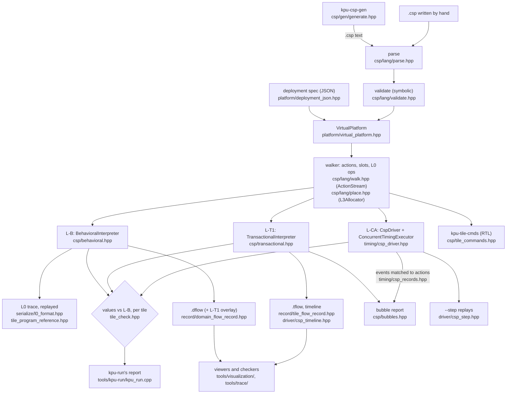

# The Simulator's Architecture: How a Program Runs

**Status:** current as of 2026-11-16 (v0.10 development). It describes the code on `main`. When
a stage below changes, update its section.

**Scope:** the path a CSP program takes through kpu-sim, from its source to the records the
viewers read. It names the code path of each stage. The *machine* being simulated, the KPU, is
described in `docs/01-architecture/` (`kpu-execution-model.md`, `kpu-architecture.md`,
`combiner.md`). The *decisions* behind this structure are the ADRs in `docs/architecture/adr/`,
ADR 0002 above all.

## 1. The one idea

**One program, executed at several levels of detail.**

- A program is a **CSP program**: communicating sequential processes, written in the CSP
  language (`.csp`, `docs/plans/csp-language.md`). It states every data movement and the reuse
  it relies on.
- **CSP is the program layer, not a fidelity** (ADR 0002). Each level is an *interpreter* of the
  same program. What a level changes is how finely it decomposes a transaction:

  | Level | Interpreter | A transaction is | Computes values |
  |---|---|---|---|
  | **L-B** behavioral | `csp::BehavioralInterpreter` | a whole move, atomic | yes, and it is the oracle |
  | **L-T1** block-sequential | `csp::TransactionalInterpreter` | one tile move, timed under its own slot's credit | yes |
  | **L-T2** resource-transactional | not built (#283) | per-resource reads and writes | — |
  | **L-CA** cycle-accurate | `timing::CspDriver` over `timing::ConcurrentTimingExecutor` | protocol events, cycle by cycle | yes |

- **Values answer to L-B; timing answers to L-CA.** Every level computes values, and every
  level's values are checked against L-B's, tile by tile.
- **Placement is behavior** (ADR 0004 §5). The walker chooses each residency's L3 and L2 slot
  once, and every level executes those slots. No level allocates a slot of its own.
- **Reuse is stated, never supplied.** A level that found reuse the program did not state would
  hide the bubbles the program has (#424).

## 2. The pipeline

The driver is `kpu-run` (`tools/kpu-run/kpu_run.cpp`). It is thin: it parses the options,
reads the program and the deployment, and calls the platform. The platform owns the run.

## 3. The stages and their code

### 3.1 Writing a program

- **`kpu-csp-gen`** (`tools/csp-gen/`, library `include/sw/kpu/program/csp/gen/generate.hpp`)
  writes `.csp` programs from a schedule: `--algo matmul | linear | lu`, `--dataflow os | ws | is`,
  `--stage-a` (L2 staging), `--dtype int8`, `--requant`, `--place`, `--format`, `--init`.
- A program can also be written by hand. The language: `docs/plans/csp-language.md`.
- `kpu-run` runs programs and never writes one (kpu-run-csp-programs step 5).

### 3.2 Parsing and validating

- **`csp/lang/parse.hpp`**: text to the program's syntax tree (`lang::Program`). A syntax error
  names its line. `csp/lang/format.hpp` prints the tree back, and the round trip is tested.
- **`csp/lang/validate.hpp`**: the **symbolic** validator. It proves residency over the loops,
  without unrolling them: every tile a statement reads is resident, and every L3 and L2 credit
  is returned. It checks the program against the deployment's sites (`lang::Target`, from
  `csp/lang/context.hpp`), such as whether the machine has a Combiner and which operations it
  runs. It reports the program's peak L3 and L2, and its loads, calls and stores.
- **`csp/lang/context.hpp`**: a result's tile context, its `via` list (bias, scale, activation,
  block format). It resolves the context in the Combiner's order and refuses what that order,
  or the result's number system, excludes.

### 3.3 The platform and the deployment

- **The deployment** (`platform/deployment_spec.hpp`, read by `platform/deployment_json.hpp`) is
  the machine: its DMA engines, BlockMovers, streamers, L3 and L2, fabric, Combiner, memory
  controllers and DRAM. Its canonical bytes have a digest, which is part of every run's identity.
- **`platform/virtual_platform.hpp`**, `VirtualPlatform`, is the one execution path:
  - `load_csp(ast, inputs)` checks the program against the device and holds it with its inputs;
  - `run_csp(handle, level, window)` runs one level and returns its outcome with a
    `RunIdentity` (program, inputs, deployment, placement, schedule). The identity is the run's
    provenance;
  - `csp_reference(handle)` is L-B's run, with its trace;
  - `step_begin(handle, level)` gives a cursor for single-stepping.
- **`driver/csp_run.hpp`** holds the level dispatch (`csp_run_level`), the inputs
  (`csp_inputs`: synthesized by operand name, or read from an L0 file's values), and the oracle
  (`csp_reference`).

### 3.4 The walker: from program to actions

- **`csp/lang/walk.hpp`**, `ActionStream`, unrolls the program **lazily** into actions, one at a
  time, so a program of any length starts at once. An action is one step of one process:
  - `Load` (DMA: DRAM to L3), `Store` (L3 to DRAM);
  - `Move` (BlockMover: L3 to L2), `Writeback` (L2 to L3);
  - `Feed` (streamer: L2 to the fabric), `Drain` (the fabric to L2);
  - `Call` (the fabric: a tile function, an L0 op);
  - `Release`, `L2Release`, `Inherit`, `Retain` (credits and residency).

  The action kinds and the program IR are in `csp/csp_program.hpp`.
- The walker **places** each residency as it opens it (`csp/lang/place.hpp`, `L3Allocator`). An
  action carries its L3 address (module, slot, bank) and its L2 slot. Every level executes them.
- The walker also checks what the symbolic validator cannot see without unrolling. Each check
  is a `CompileError` naming the line.
- `csp/lang/compile.hpp` is the eager form: the whole action list at once (`CspProgram`), for
  small programs and the tests.

### 3.5 L-B, the oracle

- **`csp/behavioral.hpp`**, `BehavioralInterpreter`, applies one action at a time to addressed
  storage: L3 slots, L2 slots and the fabric's accumulators. It refuses a write into a live slot,
  or a read of the wrong one.
- A Call computes with the L0 kernels (`tile_kernels.hpp`: gemm on the registered MAC, bias,
  activation, merge, block conversion, requantization). A tile context's stages compute with the
  same element functions, so a fused epilogue is bit-identical to an unfused one.
- Number systems come from the registry (`numeric.hpp`, on Universal): fp32, int8, int32, and
  the MX block formats.
- **The L0 trace.** As L-B runs, the walker records every action's arithmetic as L0 ops. The
  trace is replayed by `TileProgramReference` (`tile_program_reference.hpp`), and the replay
  must reproduce L-B bit for bit before the trace may be written (`kpu-run --emit-l0`).
  `serialize/l0_format.hpp` writes and reads it, with an opset version (`OPSET tile 1.x`) that
  says which ops it uses. **L-B is the one place a CSP program becomes an L0 program.**

### 3.6 L-T1, the tile-sequential timing

- **`csp/transactional.hpp`**, `TransactionalInterpreter`, times each action as one tile move
  (one leg; a Store has two) on its process's lanes:
  - a Load waits for its own L3 slot's Release;
  - a staging Move waits for its L2 slot;
  - with a declared fabric (`fabric.pe_rows`, `pe_cols`), an accumulator's gemm calls are timed
    as a systolic stream.

  Every leg is a `Record`: action, process, lane, start, finish, and the cycle it was ready.
- It computes values by running L-B's interpreter on the same actions, so its values are L-B's
  by construction. Its timing is uncalibrated, and it says so.

### 3.7 L-CA, the cycle-accurate run

- **`timing/csp_driver.hpp`**, `CspDriver`, pulls the program's actions from the walker within
  a window (`--window`, 256 by default), turns each into a `TileDescriptor`, and hands it to its
  process in the executor.
- **`timing/concurrent_timing_executor.hpp`**, `ConcurrentTimingExecutor`, is the machine,
  cycle by cycle. These processes move payloads, which are the values:
  - the DMA engines (`dma_engine_process.hpp`), the memory controllers and DRAM;
  - the BlockMovers (`block_mover_process.hpp`), the streamers (`streamer_process.hpp`);
  - the compute fabric, the Combiner, the NoC.

  Each process pushes only when it holds a downstream credit, and returns credits upstream
  (`credit_pool.hpp`). Arrivals are matched by tag (`tag_cam.hpp`). The credit model is
  `docs/01-architecture/kpu-execution-model.md`.
- `timing/csp_config_from_spec.hpp` builds the executor's config from the deployment. Fields
  it cannot model yet are listed in the run's `unmodelled`.
- It logs protocol events (`process_interface.hpp`, `TimingEvent`). With `keep_events`, the
  driver also keeps them for the step replay (`driver/csp_step.hpp`, `CspCycleStepper`), and,
  matched back to the actions (`timing/csp_records.hpp`), as L-T1-shaped records for the bubble
  report.

### 3.8 Checking the values

- **`tile_check.hpp`**, `check_operands`: every operand, every tile, read in its own number
  system. Integers are compared exactly. fp32 must lie within `|a - o| <= 1e-6 + 1e-4 |o|` of
  L-B's, because a data path may order a reduction differently.
- Bit equality is the bar only where the same computation is repeated: the trace's replay, a
  round trip, step against run, and L-B across deployments in a sweep.
- `kpu-run` exits 1 when a level disagrees. Every file it writes, it writes only after the levels
  agreed.

### 3.9 The records and the viewers

| Record | Written by | Read by |
|---|---|---|
| `.dflow` v6 (`--dflow`): every action as a CSP state transition, with tile values; with L-T1, its legs and fabric chains | `record/domain_flow_record.hpp`, from L-B's run | `tools/visualization/domainflow/`, `tools/trace/dflow_check.py` (`--result`: the CI gate) |
| `.tflow` v6 (`--tflow`): where every tile was and when, one row per L3 slot, staged L2 copies, chains | `record/tile_flow_record.hpp`, from L-T1 | `tools/visualization/tileflow/`, `tools/trace/tflow_check.py` |
| Timeline (`--timeline`): Chrome-trace intervals, one per leg | `driver/csp_timeline.hpp`, from L-T1 | any Chrome-trace viewer |
| Bubble report (`--bubbles`): each compute lane's idle time and its cause, the reuse stated, each process's load | `csp/bubbles.hpp`, from L-T1, and from L-CA through `timing/csp_records.hpp` | text |
| Steps (`--step`): L-B one action per step; L-T1 one record; L-CA one cycle | `driver/csp_step.hpp` | text |
| `kpu-tile-cmds` (`--tile-commands`): the program as the RTL's tile command stream | `csp/tile_commands.hpp` | `tools/trace/tile_cmds_run.py`; the RTL (branes-ai/embodied-ai-soc-generator#49) |

## 4. What `kpu-run` does, in order

`kpu-run --program p.csp --deploy m.json [--level ...]`, in `run_csp_program`:
1. Parse the program, and read the deployment or deployments. A repeated `--deploy` is a sweep
   (`run_csp_sweep`): the steps below run once per deployment.
2. Choose the levels: `all`, or one named. A named level that cannot run this program on this
   machine is refused with its reason (`csp_level_supported`).
3. Prepare the inputs: synthesized, or `--inputs file.l0`.
4. Load the program onto the platform (`load_csp`), validating it against the device.
5. Run the oracle (`csp_reference`): L-B, its trace, and the trace's replay.
6. Run each level (`run_csp`), each with its run identity.
7. Print each level's makespan, traffic and occupancy, and what it does not model.
8. Write the records asked for: `--dflow`, `--tflow`, `--timeline`, `--tile-commands`,
   `--bubbles`, `--step`.
9. Compare every level's values with L-B's. Exit 1 on a disagreement.
10. Only then write `--emit-l0-result`, `--emit-l0` and `--emit-l0-kernel`.

## 5. Outside this pipeline

- **An L0 program from a file** (`kpu-run --program p.l0`, `run_l0_program`) runs at L-B only.
  It is a trace, the oracle CSP runs answer to, not a program the timed levels execute.
- **The orchestration and loadable path** (ADR 0003; `include/sw/kpu/orchestration/`, `.kpuld`)
  carries `.csp` text in its operators and runs them through the same platform.
- **Frozen or retiring:** the DMProgram executors and `include/sw/kpu/models/dataflow/` (ADR 0001
  D6, #266) move tile identity and credit state but never values. Do not use them as a template.
  `TileTransactionExecutor`, the L0 L-T1 executor, retired in kpu-run-csp-programs step 4e.
- **The memory-side models** (`patterns/memory/`, LPDDR5) are characterized cycle-accurately on
  their own, with their trace validator and invariants (`patterns/memory/lpddr5/INVARIANTS.md`).

## 6. Where to read next

| To understand | Read |
|---|---|
| Why the levels are interpreters of one program | ADR 0002 (`docs/architecture/adr/0002-csp-interpretations-and-virtual-platform.md`) |
| The program contract and the oracle | ADR 0001, D5 and §7.5 |
| The CSP language as a language, and placement as behavior | ADR 0004 |
| The language itself | `docs/plans/csp-language.md` |
| How kpu-run came to run CSP programs, step by step | `docs/plans/kpu-run-csp-programs.md` |
| The machine's credit model | `docs/01-architecture/kpu-execution-model.md` |
| The Combiner | `docs/01-architecture/combiner.md` |
| The levels, and what each answers | `docs/02-simulation/fidelity-framework.md` |
| The hardware components' classes | `docs/architecture/class-diagram.md` |
